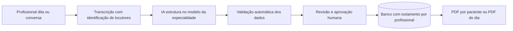

# Auris — Registro clínico por voz

O profissional de saúde fala, o Auris escreve. Um sistema web que transforma o ditado ou a conversa de uma consulta em uma ficha clínica estruturada, revisada e aprovada pelo próprio profissional, com PDF pronto para arquivar ou enviar.

> Status: piloto em validação com profissionais de saúde. Todos os dados de demonstração são fictícios.

**Demonstração em vídeo (54 s, com narração):** [docs/auris-demo.mp4](docs/auris-demo.mp4)

## O problema

Médicos, psicólogos e demais profissionais de saúde passam parte do atendimento digitando. Isso tira o olhar do paciente, alonga a consulta e leva trabalho para casa no fim do dia.

## Como funciona



1. **Dois modos de captura**
   - **Ditado:** o profissional resume o atendimento.
   - **Consulta:** conversa natural com o paciente, separando quem fala.
2. **Transcrição:** ElevenLabs Speech-to-Text em português. O áudio não é armazenado.
3. **Estruturação:** a Claude API preenche os campos do modelo escolhido. Informação não dita fica vazia, nunca inventada.
4. **Validação:** conferência de CPF, faixas de valores e campos obrigatórios por especialidade.
5. **Aprovação humana:** nada é salvo sem a revisão do profissional.
6. **Documentos:** ficha individual em PDF e relatório com todos os atendimentos do dia.

## Funcionalidades

- 12 modelos de ficha:
  - atendimento clínico geral, evolução SOAP, pediatria, pré-natal e psiquiatria;
  - psicologia, oftalmologia, odontologia, fisioterapia, nutrição, enfermagem e fonoaudiologia.
- Cadastro com profissão, as 55 especialidades médicas reconhecidas pelo CFM e número do conselho.
- Extração dos dados do paciente: identificação, contato, endereço completo e observações.
- Preferências de escrita por profissional, aplicadas em todas as fichas.
- Interface responsiva, pensada primeiro para o celular, sem instalar aplicativo.

## Decisões de produto e conformidade

| Decisão | Motivo |
| --- | --- |
| Nenhuma sugestão de diagnóstico | Alinhamento à Resolução CFM 2.454/2026 (decisão final humana) e à RDC Anvisa 657/2022 |
| Áudio processado em memória e descartado | Minimização de dados (LGPD) |
| Row Level Security no Postgres | Cada profissional acessa apenas os próprios registros |
| Chaves de API apenas no servidor | Nenhum segredo exposto no navegador |
| Aviso verbal ao paciente no modo consulta | Transparência sem burocracia na consulta |

## Stack

| Camada | Tecnologia |
| --- | --- |
| Front-end e API | Next.js 16 (App Router), React 19, TypeScript |
| Banco e autenticação | Supabase (Postgres, Auth, Row Level Security) |
| Voz para texto | ElevenLabs Speech-to-Text (scribe_v2, diarização) |
| Estruturação | Claude API (tool use com plano B em JSON) |
| Hospedagem | Vercel |

## Estrutura

```
app/
  api/processar/     transcrição + extração + validação
  novo/              gravação e revisão da ficha
  registro/[id]/     ficha individual e PDF
  dia/               PDF dos atendimentos do dia
  perfil/            profissão, especialidade e preferências
lib/
  modelos.ts         modelos de ficha e especialidades
  extracao.ts        instruções e esquema enviados à IA
  transcricao.ts     integração de voz e diarização
  validacao.ts       regras de conferência dos dados
supabase/            esquema do banco e políticas de acesso
```

## Rodar localmente

1. **Banco:** crie um projeto no Supabase e rode `supabase/schema.sql` e depois `supabase/migracao_v2.sql` no SQL Editor.
2. **Variáveis:** copie `.env.example` para `.env.local` e preencha as chaves do Supabase, da Claude e da ElevenLabs.
3. **Rodar:** execute `npm install` e depois `npm run dev`.

## Próximos passos

- Envio da ficha por e-mail ao paciente ou ao hospital.
- Lembrete de retorno.
- Aprendizado com as correções feitas pelo profissional.
- Receita digital com QR code.

## Autor

Moroni Srur — [LinkedIn](https://www.linkedin.com/in/moronisrur) · [GitHub](https://github.com/moronisr)
